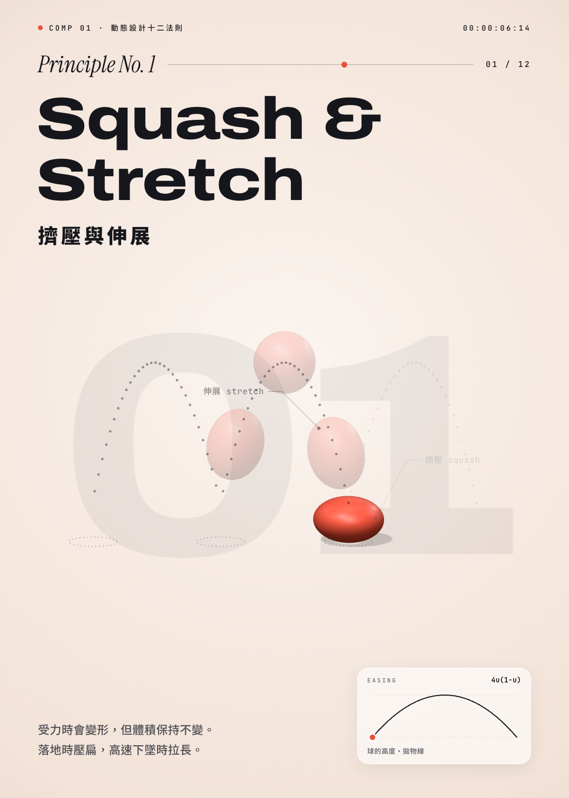

# 動態設計十二法則 The 12 Principles of Animation

iPadART 的動畫十二法則教材，用 Three.js 與 GSAP 製作的互動 3D 示範。

- **課堂版**（首頁）：<https://celesion700si.github.io/ipadart-12-principles/>
- **影片版**（66 秒自動播放）：<https://celesion700si.github.io/ipadart-12-principles/film.html>

## 課堂版 `index.html`

為 iPad 課堂設計，搭配哈佛 Project Zero「設計賦能 Agency by Design」的思考例程「零件・目的・複雜 Parts, Purposes, Complexities」，用來練習「看見動態是被設計的」。

- 點畫面暫停／播放，左右滑動切換法則；每條法則播完會自動停下。
- 進度條可以拖曳重看，速度可切換 1×、½×、¼×。
- 每條法則有三個提問（零件、目的、複雜），附可展開的參考想法；最後是「如果可以… Imagine If」。
- 作答只存在該裝置的瀏覽器，不會上傳；可以匯出文字筆記或 JSON 備份。

## 影片版 `film.html`

5:7 直式畫布（1080×1512），66 秒自動播放，適合螢幕錄影成短影音。

鍵盤：Space 暫停／播放、R 重播、← → 切換法則、數字鍵跳章（10–12 請在 0.45 秒內連按兩位數）、H 顯示進度列。

## 來源

- 林英斌老師（iPadART）的設計賦能課程：以哈佛 Project Zero「設計賦能 Agency by Design」的思考例程「零件・目的・複雜」，觀看動畫十二法則。
- 十二法則出自迪士尼動畫師 Ollie Johnston 與 Frank Thomas 的《The Illusion of Life》（1981）。
- 開啟時需要連網，以載入固定版本的 Three.js 0.160.0、GSAP 3.12.5 與 Google Fonts。

延伸閱讀：[零點群島 Project Zero Archipelago](https://islands.ipadart.net)
